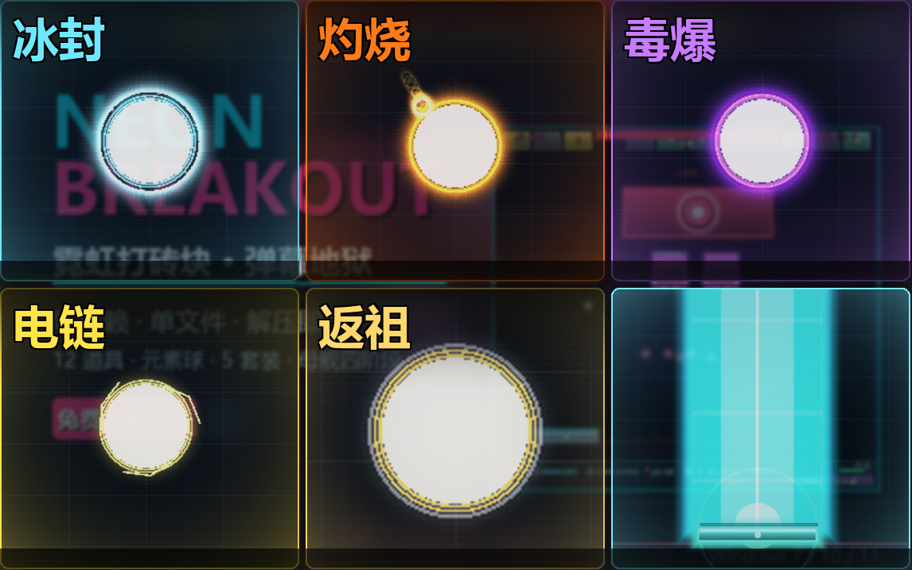
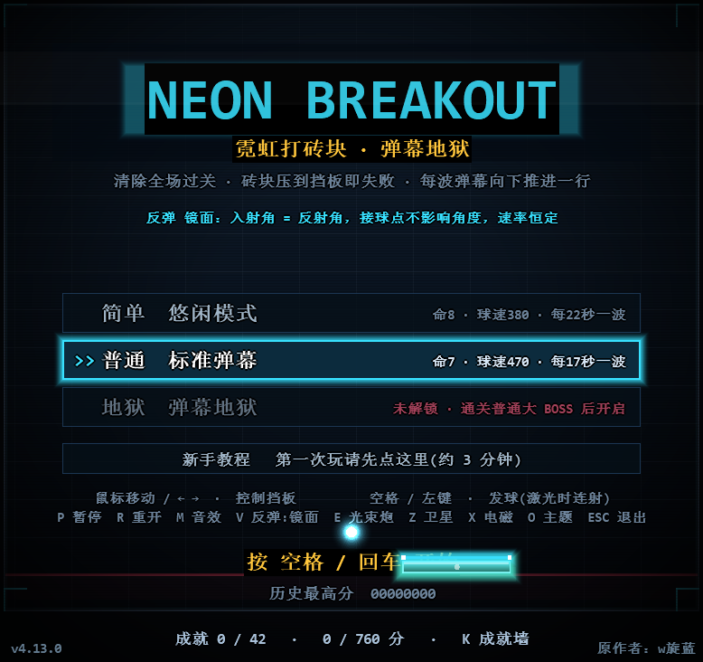
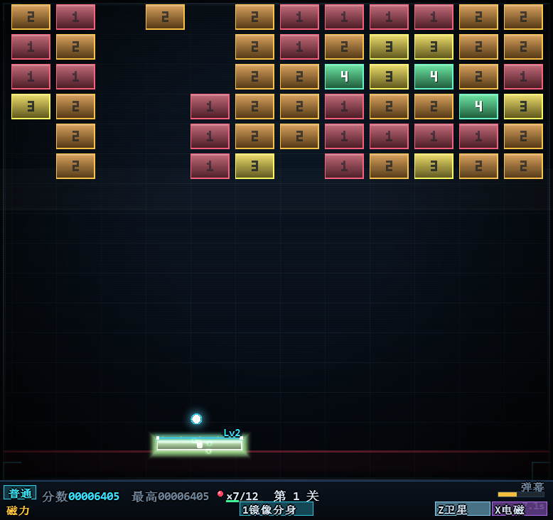

# NEON BREAKOUT · 霓虹打砖块 · 弹幕地狱

**经典打砖块 × 弹幕下压 × 实时合成配乐** —— 一个零依赖、单文件、解压即玩的 Windows 小游戏。

## 下载

👉 **[下载最新版（Releases）](../../releases/latest)** → 选 `NeonBreakout_vX.Y.Z_win64.zip`

1. 解压到任意目录
2. 双击 `NeonBreakout.exe`（或 `启动游戏.bat`）
3. 开玩 —— 不用安装、不写注册表、不联网、不需要 VC++ 运行库

## 运行要求

| 项目 | 要求 |
| --- | --- |
| 系统 | Windows 7 / 8 / 8.1 / 10 / 11（64 位） |
| 依赖 | **无**。只调用系统自带的 KERNEL32 / USER32 / GDI32 / WINMM / dwmapi / SHELL32 |
| 体积 | exe 约 906 KB，压缩包 635 KB |
| 安装 | 免安装，绿色版。设置与存档都在 exe 同目录 |

## 玩法

清掉全场砖块过关；砖墙每波向下压一行，压到挡板就扣血，血掉光就结束。**挡板血量就是你的命**——漏球、被 BOSS 子弹或激光打中都会 -1，过关 +1，血量会随时间慢慢回复。

| | 简单 | 普通 | 地狱 |
| --- | --- | --- | --- |
| 初始 / 上限血量 | 8 / 15 | 7 / 12 | 5 / 10 |
| 球速 | 380 | 470 | 540 |
| 弹幕间隔 | 22 秒 | 17 秒 | 13 秒 |
| 道具掉率 | 25% | 16% | 13% |
| 解锁 | 默认 | 默认 | 通关普通难度的大 BOSS |

- **第 4 关**小 BOSS，**第 8 关**大 BOSS（母舰四阶段），打完进奖励关，之后进无尽模式
- **12 种道具**：三球齐发、加长挡板、护盾、慢速、磁力、激光、维修……连续 10~15 块砖没掉会保底送一个
- **5 种元素球**（地狱专属，奖励关 100% 触发）：冰封 / 灼烧 / 毒爆 / 电链 / 返祖
- **5 套主题皮肤**：换皮肤会把当前难度曲整体移调（0 / +2 / +4 / +5 / +7 个半音），旋律不跳
- **42 条成就 / 760 分**，结算有 C- 到 SSS 的评级
- 三种反弹手感（原版 / 镜面）、暂停菜单、种子、修饰符、精英关

## 操作

| 键 | 作用 |
| --- | --- |
| 鼠标移动 / `←` `→` | 控制挡板 |
| `空格` / 鼠标左键 | 发球 |
| `E` | 光束炮（挡板向上打一道垂直光柱） |
| `Z` / `X` | 大招：轨道卫星 / 电磁脉冲 |
| `P` `ESC` `F` `F11` | 暂停菜单 |
| `R` | 重开本局（连按两次确认） |
| `M` / `N` | 音效 / 音乐开关 |
| `V` | 反弹模式切换 |
| `K` | 成就墙 |
| `F12` | 截图（存到 exe 同目录） |
| `↑` `↓` | 主菜单选难度 |

完整机制（砖块种类、BOSS 阶段、评分细则、成就列表）在发布包的 `玩法说明_玩家版.txt` 里，写得很细。

## 截图

| 主菜单 | 对局 |
| --- | --- |
|  |  |

## 常见问题

**首次运行提示"Windows 已保护你的电脑"？**
exe 没有做代码签名，点「更多信息 → 仍要运行」即可。介意的话可以自己拿源码编译。

**存档在哪？**
exe 同目录的 `neonbreakout_hiscore.txt`（最高分、评级、设置）和 `neonbreakout_achv.txt`（成就）。删掉这两个文件就是全新存档。

**杀毒软件报毒？**
无签名的小体积 exe 偶尔会被误报，可以加白名单，或者自己编译。

**能跑在 Mac / Linux 上吗？**
目前只有 Windows 版。用的是纯 Win32 + GDI 绘制，移植需要重写窗口层。

## 关于

- 作者：**w旋蓝**
- 技术：C++17 / Win32 / GDI 自绘 / waveOut 混音，全部音频（BGM 与音效）都是运行时合成的原创旋律，没有一个素材文件
- 这是个人独立项目，欢迎提 Issue 反馈 bug 或建议

## English

**NEON BREAKOUT** is a zero-dependency, single-file Windows breakout game with a bullet-hell twist: the brick wall presses down every wave, your paddle's HP is your life, and all music/SFX are synthesized at runtime. Download the zip from [Releases](../../releases/latest), extract, run `NeonBreakout.exe`. No installer, no runtime, no network. Windows 7–11 (x64).

## License

见 [LICENSE](LICENSE)。
